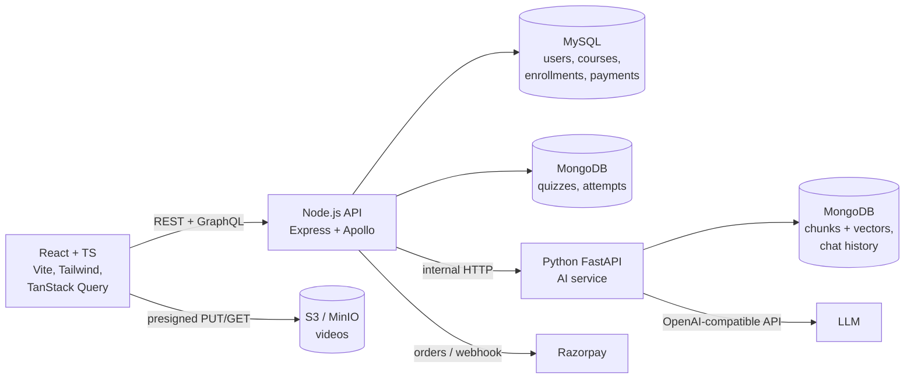

# TalentEd

An AI-powered learning platform. Educators publish video and text courses; students enroll (free or paid), track progress and take quizzes; a course-scoped **AI tutor** answers questions using only that course's lessons, with citations.

> **Live demo:** _add your URL_ · **Demo logins:** `educator@talented.dev` / `student@talented.dev`, password `Password123`

<!-- Add 2-3 screenshots here: catalog, lesson page with the tutor, course editor -->

## Features

| Area | What it does |
| --- | --- |
| Auth | Student and educator roles · 15-minute JWT access tokens · rotating HttpOnly refresh cookies with reuse detection |
| Courses | Create, edit, publish courses and Markdown lessons · cursor-paginated catalog with infinite scroll · progress tracking |
| Video | Direct-to-S3 uploads up to 2 GB with a progress bar and a verified, retry-safe completion step · signed playback URLs |
| Payments | Razorpay (test mode) checkout · signature verification · webhook · exactly-once enrollment when callback and webhook race |
| AI tutor | RAG over the course's lessons · citations link back to the lesson · follow-up questions keep context · refuses off-topic questions |
| Semantic search | Finds lessons by meaning across all published courses |
| Quizzes | One-click quiz generation from a lesson (LLM, with an offline fallback) · answers graded server-side, never sent to the browser early |
| Sharing | Password-protected, expiring preview links for draft courses |

## Architecture



| Choice | Why |
| --- | --- |
| MySQL **and** MongoDB | Relational data with money needs FKs and transactions; quizzes, chats and vectors are nested documents ([ADR 0001](docs/adr/0001-mysql-and-mongodb.md)) |
| GraphQL for reads, REST for writes | Pages fetch exactly their fields; commands keep HTTP semantics ([ADR 0002](docs/adr/0002-graphql-for-reads-rest-for-writes.md)) |
| Separate Python AI service | Python ML ecosystem, isolated scaling, internal-only ([ADR 0003](docs/adr/0003-rag-ai-tutor.md)) |
| Shared Zod schemas | One validation rule set used by the React forms and the API |

## Quick start (Docker)

Prerequisites: Docker Desktop.

```bash
cp .env.example .env          # optional: add Razorpay test keys and an LLM key
docker compose up --build
```

| URL | What |
| --- | --- |
| http://localhost:5173 | Web app |
| http://localhost:4000/graphql | GraphQL (Apollo Sandbox in dev) |
| http://localhost:8000/docs | AI service OpenAPI docs |
| http://localhost:9001 | MinIO web console (minioadmin / minioadmin) |

The first start downloads the embedding model (~130 MB) and seeds two demo courses. Without an LLM key the tutor runs in **extractive mode** (quotes the best-matching passage) and quizzes are fill-in-the-blank.

## Local development (without containerising the apps)

```bash
docker compose up -d mysql mongo minio ai   # infrastructure + AI service
npm install
npm run build:shared
cd apps/api && npx prisma migrate deploy && npm run seed && cd ../..
npm run dev:api        # http://localhost:4000
npm run dev:web        # http://localhost:5173
```

AI service on its own: `cd apps/ai && pip install -r requirements-dev.txt && uvicorn app.main:app --reload`.

## Testing

```bash
npm run test:unit -w apps/api                 # no database needed
INTEGRATION=1 npm test -w apps/api            # needs MySQL + MongoDB (compose up)
cd apps/ai && pytest -q                       # offline: mongomock + fake embedder + fake LLM
npm run lint && npm run typecheck
```

CI (GitHub Actions) runs lint, typechecks, API integration tests against real MySQL and MongoDB, AI tests, the web build, and Docker image builds on `main`.

Notable tests: refresh-token reuse revokes the session · another educator's course returns 404 · callback and webhook racing enroll exactly once · GraphQL cursor pagination hides drafts · the tutor refuses off-topic questions and only cites the asked course.

## API overview

REST (all under `/api`): `auth/{signup,login,refresh,logout,me}` · `courses` CRUD + `publish` · `courses/:id/lessons` CRUD + `complete` · `courses/:id/enroll` · `courses/:id/checkout` · `payments/{verify,webhook}` · `uploads/{presign,complete}` · `courses/:id/quizzes/generate` · `quizzes/:id` + `submit` · `courses/:id/ai/ask` · `ai/search` · `courses/:id/share` · `share/:token/unlock`

GraphQL: `courses(first, after, category, search)` · `course(id)` · `categories` · `myEnrollments` · `myCourses`

Every error has the same shape: `{ "error": { "code", "message", "details"? } }`.

## Deploying to AWS EC2

1. Ubuntu instance (2 GB+ RAM), security group open on 22 and 80.
2. `curl -fsSL https://get.docker.com | sh`
3. Clone, `cp .env.example .env`, then set strong secrets and:
   - `PUBLIC_URL=http://<server-ip>` and `VITE_API_URL=` (empty: the site's nginx proxies `/api` and `/graphql`)
   - Storage: either real S3 (`S3_ENDPOINT=` and `S3_PUBLIC_ENDPOINT=` empty, AWS keys, bucket CORS allowing PUT/GET from your site) or MinIO (`S3_PUBLIC_ENDPOINT=http://<server-ip>:9000` and open port 9000)
4. `docker compose -f docker-compose.yml -f docker-compose.prod.yml up -d --build`

## Project structure

```
packages/shared   Zod schemas + types shared by web and api
apps/api          Express + TypeScript (REST + GraphQL), Prisma (MySQL), Mongoose (MongoDB)
apps/ai           FastAPI: chunking, embeddings, vector search, RAG, quiz generation
apps/web          React + Vite + Tailwind
docs/adr          Architecture decision records
```
